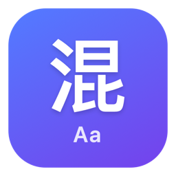
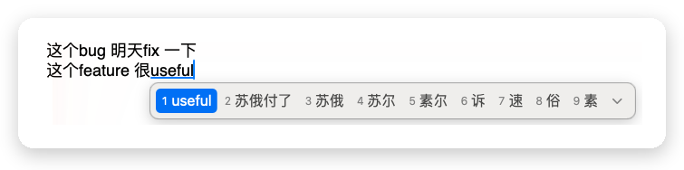
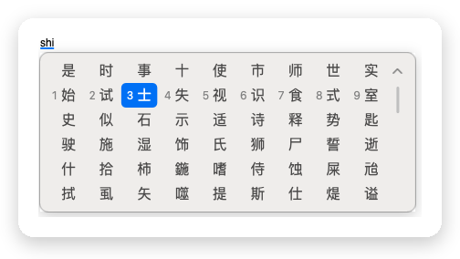
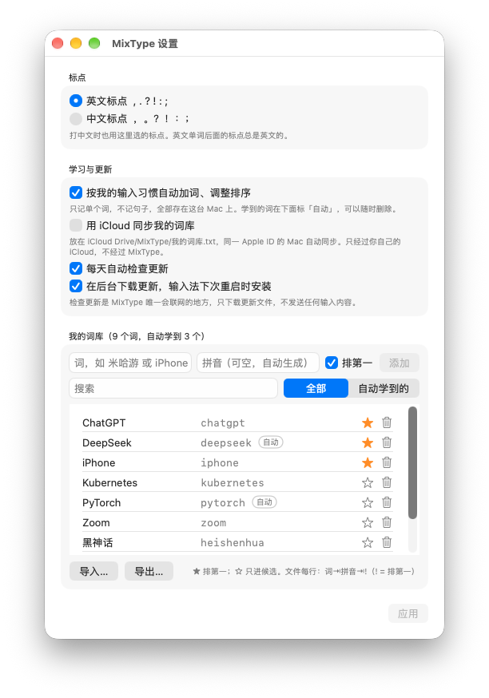

<p align="center">
  
</p>

<h1 align="center">MixType 中英混打</h1>

<p align="center">
  <b>Mac 上中英文连着打，不用切换输入法。</b><br>
  完全离线，词库只存在你自己的电脑上。
</p>

<p align="center">
  <a href="https://github.com/LinShanify/MixType/releases/latest"></a>
  
  
  
</p>

<p align="center">
  
</p>

<p align="center">
  <a href="https://github.com/LinShanify/MixType/releases/latest"><b>下载最新版</b></a> ·
  <a href="#安装">安装</a> ·
  <a href="#english">English</a>
</p>

可以当作 [UnimeType](https://unimetype.com/) 这类「免切换」输入的离线平替：不靠云端 AI，不联网打字，不收集任何输入内容。

## 为什么用 MixType

| 🔀 免切换 | 🔒 完全离线 | 🧠 越用越顺手 |
| --- | --- | --- |
| 拼音出中文，英文单词保持英文，不用按 Shift 切来切去 | 打字、选词、词库都在你的 Mac 上处理；没有账号，没有统计 | 你常打的词自动记住，候选顺序跟着你的习惯变 |

## 打起来是这样

| 你打的 | 出来的 |
| --- | --- |
| `zhege bug mingtian fix yixia` | 这个bug 明天fix 一下 |
| `ta shuo zhege feature hen useful` | 他说这个feature 很useful |
| `bangwo review yixia PR` | 帮我review 一下PR |
| `zhonngwen he recieve` | 中文和receive（拼音、英文打错都会纠正）|
| `Today's` · `don't` · `I'm` | 原样输出，撇号不会被吃掉 |
| `xi'an` | 西安 |

纠错后马上按删除键，就退回你打的原样。

## 选词和系统拼音一样

<p align="center">
  
</p>

| 按键 | 作用 |
| --- | --- |
| `1`–`9` | 选第几个候选 |
| `空格` | 选高亮的候选 |
| `←` `→` | 移动高亮 |
| `↓` | 展开成表格，方向键上下左右选；在第一行按 `↑` 收回 |
| `回车` | 没动过方向键：出你打的字母；动过：出高亮的词 |
| `-` `=` | 翻页 |

## 越用越顺手

- 候选里没出现的英文词，你照原样打出 3 次，就记住并排第一
- 纠错被你退回 2 次，这个词以后不再纠
- 同一串字母，中英文都有候选时，你 3 次都选了同一个，它就排第一
- 只记单个词，不记句子；学到的词在设置里标「自动」，可以逐个删除，也可以整个关掉

## 完全离线，数据自己掌握

<p align="center">
  
</p>

- 打字、选词、词库全部在本机处理，不上传，没有账号，没有统计
- 词库是普通文本文件，放在 `~/Library/Application Support/MixType/`，随时导出、备份、删除
- 可选：用你自己的 iCloud 云盘在几台 Mac 之间同步词库（默认关闭，不经过 MixType 的任何服务器）
- 唯一会联网的是检查更新：每天一次，只从本仓库下载更新文件，不发送任何输入内容；设置里可以关掉

## 安装

1. 在 [Releases](https://github.com/LinShanify/MixType/releases/latest) 下载最新的 `MixType-x.x.pkg`，双击安装。装到当前用户，不需要管理员密码
2. 安装程序会自动添加输入法；如果菜单栏没有「混」，到 系统设置 → 键盘 → 输入法 里添加 MixType
3. 菜单栏「混」→「MixType 设置…」可以改标点、管理词库

如果提示「无法验证开发者」，右键安装包选「打开」。

## 更新

装好以后每天自动检查一次，有新版本在后台下载，输入法下次重启时装上，通常只下载一两百 KB 的补丁。也可以在菜单栏「混」→「检查更新…」手动检查。

## 自己的词库

设置里可以加词、导入、导出。文件每行一个词，用 Tab 分隔：

```
米哈游	mihayou	50	!
Kubernetes	kubernetes
```

`!` 表示这串字母一打就排第一；不加的话只进候选，不挤掉常用词。

## 系统要求

macOS 12 或更高，Apple 芯片和 Intel 芯片都可以。目前支持简体中文和英文。

## 用到的开源项目

输入引擎 [librime](https://github.com/rime/librime) 与 librime-lua，自动更新 [Sparkle](https://sparkle-project.org)。词库来自 jieba、THUOCL、HanLP、SCOWL、Tatoeba、pinyin-data、phrase-pinyin-data。许可证随安装包附在 `MixType.app/Contents/Resources/SharedSupport/LICENSES/`。

---

<a id="english"></a>

**English** · MixType is a macOS input method for typing Chinese (pinyin) and English together without switching modes. It corrects typos in both languages, keeps English contractions like `don't` intact, and learns your words and picks over time, on your Mac only. Everything runs offline; the only network access is a daily update check against this repository, which can be switched off. macOS 12+, Apple silicon and Intel. [Download the latest release](https://github.com/LinShanify/MixType/releases/latest).
